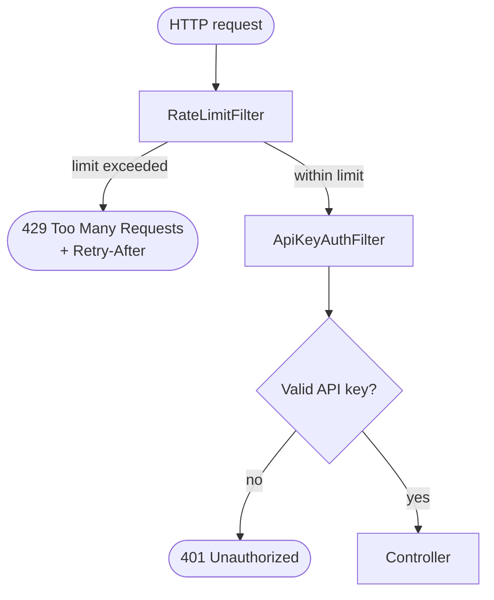
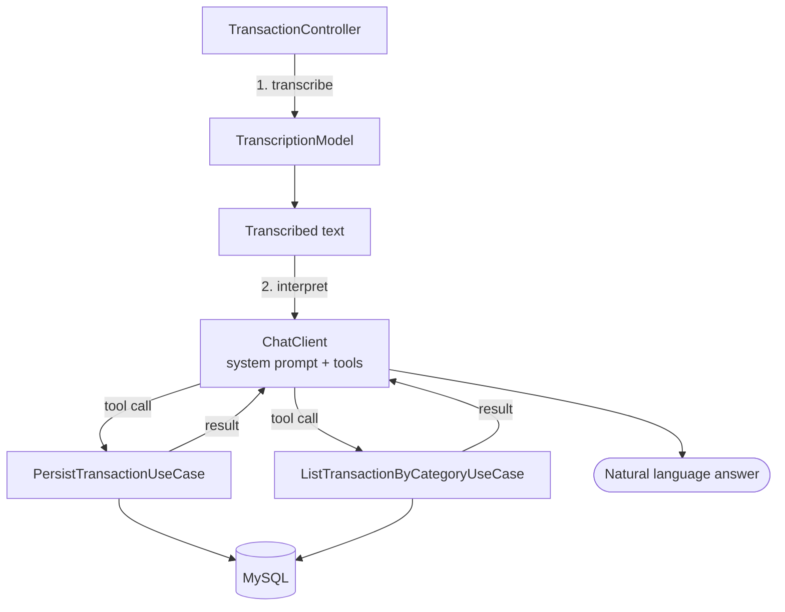

# 💸 FinancialAI

**Um assistente de finanças pessoais com IA, feito com Java e Spring Boot.**

Registre gastos por uma API REST — ou simplesmente envie um áudio dizendo o que gastou.

🌐 [English](README.md) · **Português**

      

---

## 📌 Sobre

O FinancialAI permite que o usuário registre o que gastou e entende mensagens como:

> *“Gastei 35 reais na padaria.” · “Paguei 80 reais na farmácia.” · “Comprei um fone online por 150 reais.”*

> *“I spent 35 reais at the bakery.” · “I paid 80 reais at the pharmacy.” · “I bought headphones online for 150 reais.”*

A ideia central do projeto é uma **separação rígida de responsabilidades**:

> 🧠 **A IA interpreta o que o usuário disse.**
>
> ⚙️ **O Java decide o que pode de fato ser executado e persiste os dados.**
>
> 🔐 **Uma camada de segurança decide quem pode pedir, e com que frequência.**

O modelo nunca acessa o banco de dados. Ele só pode chamar as **tools** que o Java expõe — cada uma apoiada em um caso de uso comum — e toda requisição só chega ao modelo depois de passar pelo rate limiting e pela autenticação.

Este projeto foi construído como projeto de portfólio para um bootcamp. Depois da primeira versão funcionando, foquei em uma pergunta que a maioria dos tutoriais pula: *o que acontece quando alguém que não sou eu chama esta API?*

## 📑 Sumário

- [Tecnologias](#-tecnologias)
- [Funcionalidades](#-funcionalidades)
- [O processo](#-o-processo)
- [O que aprendi](#-o-que-aprendi)
- [Como pode melhorar](#-como-pode-melhorar)
- [Como rodar o projeto](#-como-rodar-o-projeto)

---

## 🛠 Tecnologias

| Área | Tecnologia |
| --- | --- |
| Linguagem | Java 21 |
| Framework | Spring Boot 4.1.1 |
| Integração com IA | Spring AI 2.0.1 via OpenRouter (API compatível com OpenAI) |
| Segurança | Spring Security (API key stateless) + rate limiter próprio |
| Banco de dados | MySQL 9.6 (Docker Compose) |
| Persistência | Spring Data JPA + Hibernate |
| Build | Gradle |
| Utilitários | Lombok |
| Ferramentas | IntelliJ IDEA, Insomnia, curl |

O `ChatClient` do Spring AI conecta a aplicação ao modelo e registra os casos de uso como **tools** que o modelo pode chamar. O `TranscriptionModel` do Spring AI transforma um arquivo de áudio em texto.

---

## 🚀 Funcionalidades

### 💳 Transações

Uma Transaction é um registro financeiro.

- Identificada por um UUID
- Descrição (1 a 255 caracteres) e valor (um número inteiro positivo)
- Categoria: `GROCERIES`, `PHARMA`, `E_BUY`

Essas regras são verificadas no construtor da classe de domínio `Transaction`, então valem tanto para o endpoint REST quanto para as tools chamadas pelo modelo.

| Método | Endpoint | Finalidade |
| --- | --- | --- |
| `POST` | `/transaction` | Criar uma transação (corpo JSON) |
| `GET` | `/transaction/{category}` | Listar transações de uma categoria |
| `POST` | `/transaction/ai` | Enviar um **áudio** (multipart `file`); a IA registra ou lista transações |
| `POST` | `/api/transcribe` | Enviar um **áudio** (multipart `file`) e receber apenas a transcrição |

Todos exigem o header `X-API-Key`.

### 🎙 Registro por voz

Envie um áudio como *“Gastei 35 reais na padaria”* (*“I spent 35 reais at the bakery”*) e a aplicação:

1. transcreve o áudio para texto,
2. deixa o modelo interpretar a frase e escolher a tool certa,
3. executa o caso de uso Java correspondente,
4. responde em linguagem natural.

Áudios de exemplo (`padaria.mp3`, `farmacia.mp3`, `compraVirtual.mp3`) estão em `src/main/resources/audios`.

### 🧰 Tools expostas ao modelo

| Tool | Caso de uso | O que faz |
| --- | --- | --- |
| `persist-transaction` | `PersistTransactionUseCase` | Cria e salva uma nova transação |
| `list-transaction-by-category` | `ListTransactionByCategoryUseCase` | Lista transações de uma categoria |

O modelo só consegue fazer o que essas duas tools permitem.

> ⚠️ **Limitação conhecida:** o fluxo de áudio precisa de um provedor que ofereça speech-to-text por um endpoint compatível com OpenAI (configurado aqui para `whisper-1`, em português brasileiro). Não encontrei um modelo gratuito para transcrição ou text-to-speech, então os recursos de voz dependem de um provedor com acesso a um. Text-to-speech não está implementado.

### 🔐 Autenticação por API key

- O cliente envia `X-API-Key: <key>` em cada requisição.
- O servidor é **stateless**: sem sessão, sem cookies. É também por isso que a proteção CSRF está desabilitada — não existe credencial ambiente que um navegador envie por conta própria.
- Apenas um mecanismo está habilitado: HTTP Basic, form login e logout estão desligados para reduzir a superfície de ataque.
- Sem uma chave válida, a resposta é `401 Unauthorized` com corpo vazio.
- A chave é lida de `APP_API_KEY`. **Se estiver ausente ou tiver menos de 32 caracteres, a aplicação não inicia.**

### ⏱ Rate limiting

- Conta requisições **por IP do cliente** em uma janela de tempo fixa (1 minuto).
- Dois níveis independentes:

| Nível | Endpoints | Limite padrão |
| --- | --- | --- |
| IA | `/transaction/ai` | **5 requisições/minuto** |
| Geral | todo o resto | **60 requisições/minuto** |

- Quando o limite é excedido, a requisição é barrada antes de chegar ao controller — o modelo nunca é chamado:

```
HTTP/1.1 429 Too Many Requests
Retry-After: 30
Content-Type: application/json

{"error":"rate_limit_exceeded"}
```

- Thread-safe: cada atualização de contador é atômica, então requisições concorrentes não conseguem passar do limite.

### 🛡 Ameaças e contramedidas

| Ameaça | Contramedida |
| --- | --- |
| Qualquer pessoa chamando endpoints que usam o modelo | API key exigida em toda requisição (`401` caso contrário) |
| Esgotar a cota gratuita do modelo | Rate limiting, bem mais rígido em `/transaction/ai` |
| Força bruta na API key | O rate limiting roda **antes** da autenticação; as chaves precisam de 32+ caracteres |
| Timing attacks na comparação da chave | Comparação em tempo constante (`MessageDigest.isEqual`) |
| Burlar o limite forjando `X-Forwarded-For` | O limiter usa apenas o endereço real da conexão |
| Uploads grandes demais | Limites de multipart de 2 MB |
| Vazamento de segredos | Somente variáveis de ambiente; nada sensível no repositório |

### ⚙️ Configuração

| Propriedade | Padrão | Descrição |
| --- | --- | --- |
| `app.security.api-key` | `${APP_API_KEY}` | A API key (mín. 32 caracteres) |
| `app.rate-limit.general.requests-per-minute` | `60` | Limite dos endpoints comuns |
| `app.rate-limit.ai.requests-per-minute` | `5` | Limite dos endpoints de IA |
| `spring.servlet.multipart.max-file-size` | `2MB` | Tamanho máximo de um arquivo enviado |
| `spring.servlet.multipart.max-request-size` | `2MB` | Tamanho máximo de uma requisição multipart |

### 🚧 Limitações conhecidas

São trade-offs conscientes, não descuidos:

- **O estado fica em memória.** Os contadores vivem em uma instância e zeram ao reiniciar; com várias instâncias, cada uma contaria separadamente.
- **A janela fixa** permite uma rajada curta (até o dobro do limite) na virada da janela.
- **Uma chave compartilhada, sem usuários.** As transações não têm dono; quem tem a chave vê tudo.
- **Atrás de um proxy reverso**, todos os clientes compartilhariam o endereço do proxy até que headers de proxy confiável sejam configurados.

E uma que ainda precisa de trabalho:

- **`/api/transcribe` está no nível geral.** Ele chama o modelo de transcrição, mas é limitado a 60 requisições/minuto, porque apenas `/transaction/ai` está listado como caminho de IA.

---

## 🔄 O processo

Toda requisição passa pelo mesmo pipeline antes de qualquer código de negócio rodar.



### 1. De uma API aberta a uma API protegida

A primeira versão tinha um fluxo de IA funcionando, mas **nenhuma proteção**: todos os endpoints eram abertos, inclusive os que chamam o modelo de linguagem. Qualquer pessoa que encontrasse a URL poderia gastar a cota do modelo (que, em um plano gratuito, é pequena) ou gravar transações no banco de dados.

Esta versão adiciona (e remove):

| Mudança | Por quê |
| --- | --- |
| **Rotas experimentais de chat removidas** (`/chatmodel`, `/api/chat`) | Elas repassavam prompts crus ao modelo sem finalidade de negócio, o que só aumentava a superfície de ataque. As classes de controller continuam no código, sem nenhuma rota; `/api/transcribe` continua mapeado. |
| **Autenticação por API key** (header `X-API-Key`, Spring Security, stateless) | Só clientes que conhecem a chave podem usar a API |
| **Rate limiting por IP do cliente**, com limite mais rígido para `/transaction/ai` | Protege a cota do modelo e desacelera abusos |
| **Rate limit antes da autenticação** | Tentar adivinhar a chave também é limitado |
| **Configuração fail-fast** | A aplicação se recusa a iniciar com uma API key ausente ou curta |
| **Limite de tamanho de upload** (2 MB) | Arquivos de áudio não conseguem esgotar memória ou banda |
| **Segredos apenas por variáveis de ambiente** | Nenhuma chave no repositório |
| **Limites configuráveis por propriedades** | Os limites mudam sem tocar no código |

### 2. Rate limiting — o primeiro portão

O `RateLimitFilter` escolhe o limiter de IA ou o geral a partir do caminho da requisição e pergunta ao `FixedWindowRateLimiter` se esse cliente pode continuar. Fazer isso primeiro significa que uma enxurrada de requisições, mesmo inválidas, nunca chega à autenticação nem ao modelo.

### 3. Autenticação

O `ApiKeyAuthFilter` apenas **identifica**: se o header confere, ele marca a requisição como autenticada. Ele nunca rejeita nada por conta própria. A rejeição vem da regra de autorização (`anyRequest().authenticated()`), que responde `401`. Identificar e decidir são responsabilidades separadas.

### 4. O fluxo de IA

Para `POST /transaction/ai`, depois que a requisição é liberada:



Por exemplo, o áudio *“Gastei 35 reais na padaria”* é transcrito, e o modelo decide chamar:

```json
{
  "tool": "persist-transaction",
  "arguments": { "description": "Padaria", "category": "GROCERIES", "amount": 35 }
}
```

O Java executa o caso de uso, salva o registro, e o resultado volta ao modelo, que escreve a resposta final. **O modelo propõe; o Java executa.**

### 5. Lógica de negócio e camadas

O código é organizado em camadas com dependência em um único sentido (nomes dos pacotes como estão no código):

```
domain           Transaction, TransactionID, Category, TransactionRepository
application      PersistTransactionUseCase, ListTransactionByCategoryUseCase
infraestructure  HTTP controller, JPA persistence, API key, rate limiting, configuration
```

Segurança e rate limiting ficam na camada de infraestrutura de propósito: são preocupações de HTTP, então o domínio e os casos de uso não mudaram em nada.

---

## 📚 O que aprendi

### A cadeia de filtros do Spring Security

Uma requisição atravessa uma cadeia de filtros antes de chegar ao controller. Cada filtro pode passá-la adiante ou barrá-la. Escrever meus próprios filtros e colocá-los na ordem certa deixou claro **onde** cada decisão acontece.

### Autenticação vs. autorização

Autenticação responde *“quem é você?”* e autorização responde *“você pode entrar?”*. Meu filtro apenas autentica; uma regra separada autoriza. Mantê-las separadas é uma ideia central do Spring Security.

### Algoritmos de rate limiting e seus trade-offs

Janela fixa, janela deslizante e token bucket resolvem o mesmo problema com custos diferentes. Escolhi a janela fixa pela simplicidade e aprendi exatamente do que ela abre mão (a rajada na virada da janela) e o que mudaria em um cenário distribuído (um armazenamento compartilhado, como o Redis).

### Concorrência

Duas requisições do mesmo cliente podem chegar no mesmo instante. Um simples ler-e-depois-escrever em um contador perde atualizações. Usar `ConcurrentHashMap.compute` junto com `record`s **imutáveis** torna a atualização atômica sem locks explícitos.

### O tempo como dependência

O limiter recebe um `Clock` em vez de ler a hora do sistema por conta própria, o que torna o comportamento baseado em tempo controlável e testável.

### Detalhes de segurança que importam

- Comparar segredos em **tempo constante**, para que o tempo de resposta não revele nada sobre a chave.
- Nunca confiar em um header controlado pelo cliente (`X-Forwarded-For`) para identificá-lo.
- **Falhar rápido** diante de uma configuração fraca, em vez de rodar desprotegido.
- Desabilitar o CSRF apenas porque a API é stateless e não usa cookies — não por reflexo.

### Gerenciamento de segredos

Chaves pertencem a variáveis de ambiente, nunca ao repositório. Também aprendi que uma entrada no `.gitignore` **não** protege um arquivo que o Git já rastreia, e que uma chave vazada deve ser tratada como comprometida e substituída.

### Spring AI com tool calling

Expor casos de uso como tools permite que o modelo aja sem nunca tocar no banco de dados. Também me mostrou que os argumentos do modelo são **entrada de uma fonte não confiável** e merecem o mesmo cuidado que qualquer entrada de usuário.

### Testando as proteções manualmente

Validei o comportamento com curl e Insomnia: `401` sem chave, `200` com ela e `429` quando o limite foi excedido.

---

## 🔮 Como pode melhorar

| Melhoria | Descrição |
| --- | --- |
| **Autenticação por usuário** | Trocar a chave compartilhada por JWT ou OAuth2 e dar um dono a cada transação, para que cada usuário veja apenas os próprios dados. |
| **Rate limiting distribuído** | Migrar para um token bucket (por exemplo, Bucket4j) com Redis, para que os limites valham entre várias instâncias e após reinícios. |
| **Respostas de erro** | `Transaction` rejeita dados inválidos com uma `InvalidTransactionException`, mas não há um exception handler que a transforme em uma resposta `400` com mensagem clara. |
| **Endpoint de transcrição** | Colocar `/api/transcribe` sob o limite de IA, ou removê-lo junto com as duas classes de controller que ficaram sem rotas. |
| **Validação do upload de áudio** | Verificar o content type e a assinatura do arquivo, não só o tamanho. |
| **Testes de segurança automatizados** | Testes unitários do limiter com um relógio falso e testes de integração para `401` / `429` passando pela cadeia de filtros real. |
| **Interação por voz** | Speech-to-text e text-to-speech com um provedor disponível para mim, para um ciclo de voz completo. |
| **Observabilidade** | Trocar `System.out` por logging estruturado e acompanhar bloqueios por rate limit e falhas de autenticação. |
| **Deploy** | Rodar atrás de HTTPS e de um proxy reverso, com headers de encaminhamento confiáveis e segredos vindos do cofre da plataforma. |
| **Frontend** | Um painel com gastos por categoria e um botão de gravação. |

---

## ▶ Como rodar o projeto

### Requisitos

- Java 21
- Docker (para o container do MySQL)
- Git
- Uma chave de API do [OpenRouter](https://openrouter.ai)
- IntelliJ IDEA (ou outra IDE Java)

### 1. Clone o repositório

```bash
git clone https://github.com/G-Delboni/SpringAiFinancial.git
cd SpringAiFinancial
```

### 2. Defina as variáveis de ambiente

Nunca faça commit de segredos. Defina estas variáveis de ambiente (ou use um `.env` local, não rastreado, para o Docker Compose):

| Variável | Finalidade |
| --- | --- |
| `OPENROUTER_API_KEY` | Acesso ao provedor do modelo |
| `APP_API_KEY` | A chave que os clientes devem enviar em `X-API-Key` (mín. 32 caracteres) |
| `MYSQL_ROOT_PASSWORD` | Senha do root do MySQL |
| `MYSQL_PASSWORD` | Senha do usuário de banco da aplicação |

Gere uma `APP_API_KEY` forte localmente (qualquer uma das opções funciona):

```bash
# Java (JDK 21)
jshell
jshell> var b = new byte[32]; new java.security.SecureRandom().nextBytes(b); java.util.HexFormat.of().formatHex(b)

# Python
python -c "import secrets; print(secrets.token_hex(32))"
```

No Windows, defina as variáveis de forma permanente em *Variáveis de Ambiente* (nível de usuário) e depois **reinicie o terminal e a IDE** para que elas sejam carregadas.

### 3. Rode a aplicação

```bash
./gradlew bootRun
```

No Windows:

```bash
gradlew.bat bootRun
```

O Spring Boot sobe o container do MySQL a partir do `docker-compose.yaml` automaticamente (banco `transaction`, publicado na porta `3307` do host). A API ficará disponível em `http://localhost:8080`.

### 4. Experimente

```bash
# List transactions of a category
curl -H "X-API-Key: $APP_API_KEY" http://localhost:8080/transaction/GROCERIES

# Create a transaction
curl -X POST http://localhost:8080/transaction \
  -H "X-API-Key: $APP_API_KEY" \
  -H "Content-Type: application/json" \
  -d '{"description":"Supermarket","category":"GROCERIES","amount":50}'

# Register an expense from an audio
curl -X POST http://localhost:8080/transaction/ai \
  -H "X-API-Key: $APP_API_KEY" \
  -F "file=@src/main/resources/audios/padaria.mp3"
```

No PowerShell, use `curl.exe` (o `curl` puro é um alias de outro comando) e `$env:APP_API_KEY`.

### 5. Teste as proteções

| O que fazer | Resultado esperado |
| --- | --- |
| Chamar qualquer endpoint **sem** o header | `401` |
| Chamar com uma chave errada | `401` |
| Chamar `/transaction/GROCERIES` com a chave certa | `200` |
| Enviar 6 requisições a `POST /transaction/ai` em um minuto | a 6ª retorna `429` com `Retry-After` |
| Enviar 65 requisições a um endpoint comum em um minuto | as últimas retornam `429` |

> 💡 O rate limiting roda antes da autenticação, então dá para testar o limite de IA enviando `POST /transaction/ai` **sem o header da chave** (`401` ×5, depois `429`) sem nunca gastar a cota do modelo.

### 6. Rode os testes

```bash
./gradlew test
```

Há duas classes de teste: `FinancialAiApplicationTests` carrega o contexto do Spring, e `OpenRouterChatModelIT` envia um prompt real ao modelo e só roda quando `OPENROUTER_API_KEY` está definida. Ainda não há testes automatizados para o rate limiter nem para os filtros de segurança.

---

Feito por **Gabriel Delboni Dias** ·
[LinkedIn](https://www.linkedin.com/in/gabriel-delboni-dias/) ·
[GitHub](https://github.com/G-Delboni)
